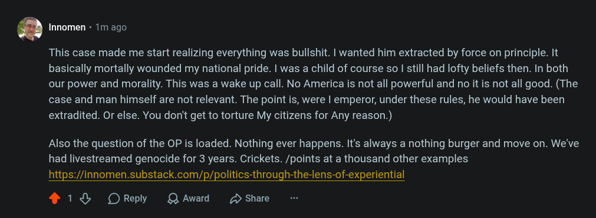

# Public Take transcript

## Machine transcription

Q Innomen « 1m ago

This case made me start realizing everything was bullshit. | wanted him extracted by force on principle. It
basically mortally wounded my national pride. | was a child of course so I still had lofty beliefs then. In both
our power and morality. This was a wake up call. No America is not all powerful and no it is not all good. (The
case and man himself are not relevant. The point is, were | emperor, under these rules, he would have been
extradited. Or else. You don't get to torture My citizens for Any reason.)

Also the question of the OP is loaded. Nothing ever happens. It's always a nothing burger and move on. We've
had livestreamed genocide for 3 years. Crickets. /points at a thousand other examples
https://innomen.substack.com/p/politics-through-the-lens-of-experiential

418 OReply QAward 2 Share
