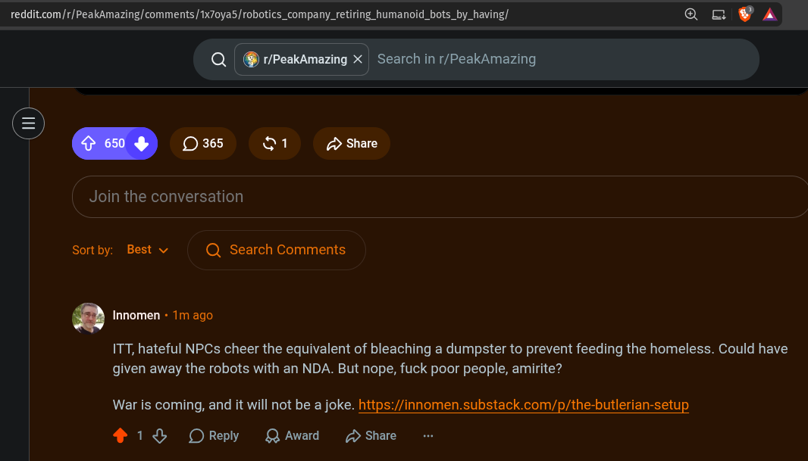

# Public Take transcript

## Machine transcription

reddit.com/r/PeakAmazing/ comments| Tx7oyas/ robotics_company_retiring_humanoid_bots_by_having/ Q=N 2V

Q| @ r/PeakAmazing X = Search in r/PeakAmazing

Join the conversation

Sortby: Best v Q Search Comments

Q Innomen + 1m ago

ITT, hateful NPCs cheer the equivalent of bleaching a dumpster to prevent feeding the homeless. Could have
given away the robots with an NDA. But nope, fuck poor people, amirite?

War is coming, and it will not be a joke. https://innomen.substack.com/p/the-butlerian-setup

4 18% OReply QAward 2 Share
