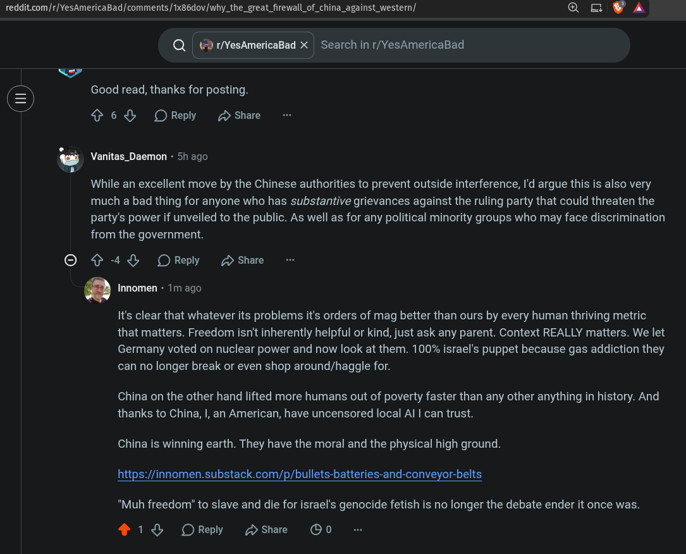

# Public Take transcript

## Machine transcription

reddit.com/r/YesAmericaBad/comments/1x86dov/why_the_great_firewall_of_china_against_western/ [CEN=0N VN

Q| 2 1/YesAmericaBad X = Search in r/YesAmericaBad

Good read, thanks for posting.
¢ 6% OReply (D Share

Vanitas_Daemon - 51 ago

While an excellent move by the Chinese authorities to prevent outside interference, I'd argue this is also very
much a bad thing for anyone who has substantive grievances against the ruling party that could threaten the
party's power if unveiled to the public. As well as for any political minority groups who may face discrimination
from the government.

© ¢ 4% OReply D share

‘ Innomen - 1m ago

It's clear that whatever its problems it's orders of mag better than ours by every human thriving metric
that matters. Freedom isn't inherently helpful or kind, just ask any parent. Context REALLY matters. We let
Germany voted on nuclear power and now look at them. 100% israel's puppet because gas addiction they
can no longer break or even shop around/haggle for.

China on the other hand lifted more humans out of poverty faster than any other anything in history. And
thanks to China, I, an American, have uncensored local Al | can trust.

China is winning earth. They have the moral and the physical high ground.

https:/innomen.substack.com/p/bullets-batteries-and-conveyor-belts

"Muh freedom" to slave and die for israel's genocide fetish is no longer the debate ender it once was.

2 1% OReply Hshae OO0
