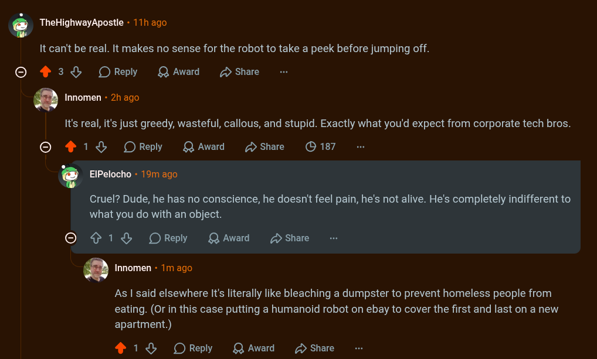

# Public Take transcript

## Machine transcription

Q TheHighwayApostle - 11h ago

It can't be real. It makes no sense for the robot to take a peek before jumping off.

O 438% OReply QAward D Share

’ Innomen - 2h ago

It's real, it's just greedy, wasteful, callous, and stupid. Exactly what you'd expect from corporate tech bros.

O 1% OReply QAward Sshare (O 187

’ ElPelocho - 19m ago

Cruel? Dude, he has no conscience, he doesn't feel pain, he's not alive. He's completely indifferent to
what you do with an object.

O ¢ 1% OReply QAward 2 Share

‘ Innomen - 1m ago.

As | said elsewhere It's literally like bleaching a dumpster to prevent homeless people from
eating. (Or in this case putting a humanoid robot on ebay to cover the first and last on a new
apartment.)

418 OReply QAward 2 Share
