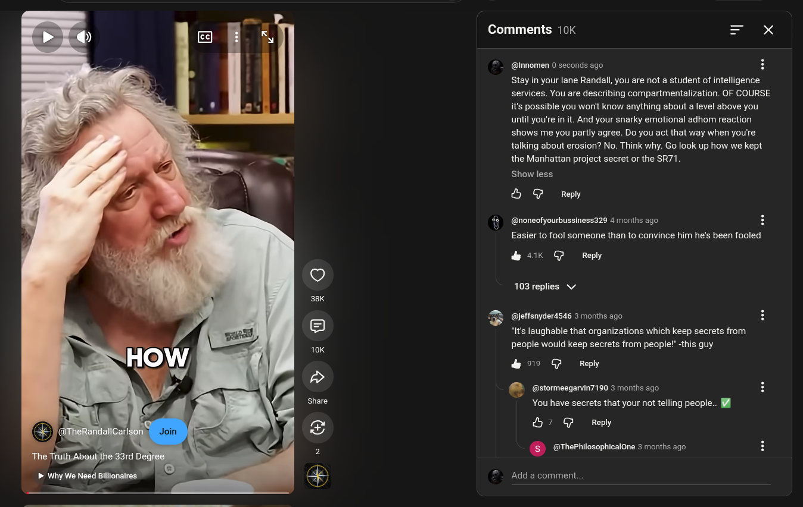

# Public Take transcript

## Machine transcription

> Why We Need Billionalres

Comments 10K = X

=

U

@Innomen 0 seconds ago

Stay in your lane Randall, you are not a student of intelligence
services. You are describing compartmentalization. OF COURSE
it's possible you wont know anything about a level above you
until you're in it. And your snarky emotional adhom reaction
shows me you partly agree. Do you act that way when you're
talking about erosion? No. Think why. Go look up how we kept
the Manhattan project secret or the SR71.

Show less

& @ Reply

@noneofyourbussiness329 4 months ago
Easier to fool someone than to convince him he's been fooled

& 4K @ Reply

103 replies v/

@leffsnyderasas 3 months ago

“It's laughable that organizations which keep secrets from
people would keep secrets from people!” -this guy

& 09 G Repy

’ (@stormeegarvin7190 3 months ago
g
You have secrets that your not telling people.. ¥l

H7 @G repy

. (@ThePhilosophicalone 3 months ago

- Add a comment.
