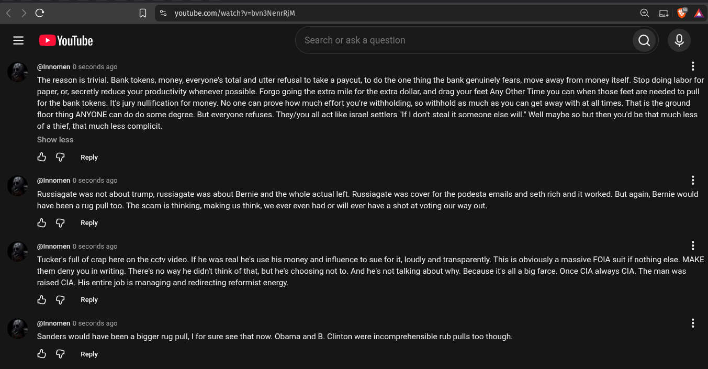

# Public Take transcript

## Machine transcription

< >C [l % youtube.com/watch?v=bvn3NenrRjM Qo ¥ A

5 YouTube

arch or ask a question Q ()

@nnomen 0 seconds ago

The reason is trivial. Bank tokens, money, everyone's total and utter refusal to take a paycut, to do the one thing the bank genuinely fears, move away from money itself. Stop doing labor for
paper, o, secretly reduce your productivity whenever possible. Forgo going the extra mile for the extra dollar, and drag your feet Any Other Time you can when those feet are needed to pull
for the bank tokens. Its jury nullfication for money. No one can prove how much effort you're withholding, so withhold as much as you can get away with at all times. That is the ground
floor thing ANYONE can do do some degree. But everyone refuses. They/you all act like israel settlers 'If | don't steal it someone else will. Well maybe so but then youd be that much less
of a thief, that much less complicit.

Show less
& G Repy

@nnomen 0 seconds ago

Russiagate was not about trump, russiagate was about Berie and the whole actual left. Russiagate was cover for the podesta emails and seth rich and it worked. But again, Bernie would
have been a rug pul too. The scam is thinking, making us think, we ever even had or will ever have a shot at voting our way out.

& G Reply

@nnomen 0 seconds ago

Tucker's full of crap here on the cctv video. If he was real he's use his money and influence to sue for it, loudly and transparently. This is obviously a massive FOIA suit if nothing else. MAKE
them deny you in writing. There's no way he didn't think of that, but he's choosing not to. And he's not talking about why. Because its all a big farce. Once CIA always CIA. The man was.
raised CIA. His entire job is managing and redirecting reformist energy.

& G Reply

@nnomen 0 seconds ago

Sanders would have been a bigger rug pull, | for sure see that now. Obama and B. Clinton were incomprehensible rub pulls too though.

& G Repy
