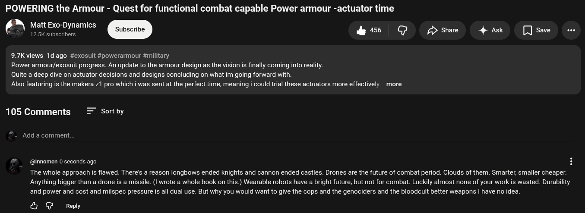

# Public Take transcript

## Machine transcription

POWERING the Armour - Quest for functional combat capable Power armour -actuator time

Matt Exo-Dynamics
tfl 12.5K subscribers & QP A> Share 4 Ask [save o

97K views 1dago #exosuit #powerarmour #military

Power armour/exosuit progress. An update to the armour design as the vision is finally coming into reality.

Quite a deep dive on actuator decisions and designs concluding on what im going forward with.

Also featuring is the makera 1 pro which i was sent at the perfect time, meaning i could trial these actuators more effectively. more

105 Comments

Sort by

Add a comment.

@nnomen 0 seconds ago

The whole approach s flawed. There's a reason longbows ended knights and cannon ended castles. Drones are the future of combat period. Clouds of them. Smarter, smaller cheaper.
Anything bigger than a drone is a missile. (I wrote a whole book on this.) Wearable robots have a bright future, but not for combat. Luckily almost none of your work is wasted. Durability
and power and cost and milspec pressure is all dual use. But why you would want to give the cops and the genociders and the bloodcult better weapons | have no idea

& G Repy
