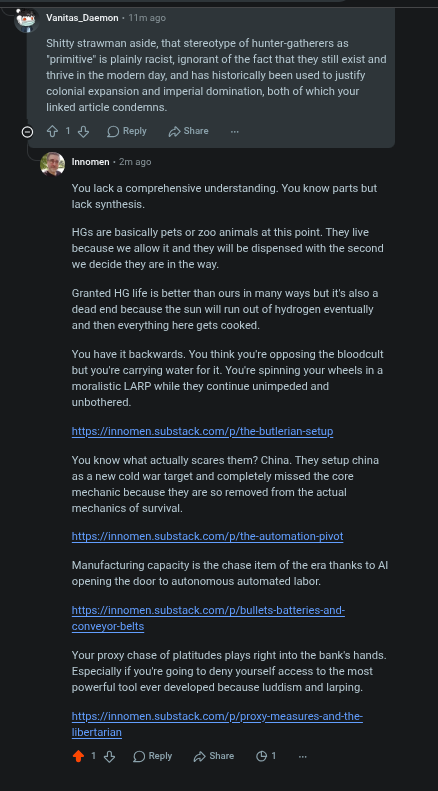

# Public Take transcript

## Machine transcription

@ Vortss Demon - 111200

Shittystrawman aside, that stereotype of hunter-gatherers as
“primitive" is plainly racist, ignorant of the fact that they il exist and
thrive in the modern day,and has historically been used o justfy
colonial expansion and imperal domination, both of which your
linked artcle condemns.

© ¢1 8 ORey @ shae

. Innomen - 2 ago

Youlack a comprehensive understanding. You know parts but
lack synthesis.

HGs are basically pets or 200 animals at this point. They live
because we allow t and they will be dispensed with the second
we decide they are i the way.

Granted HG e is better than ours in many ways but ts also @
dead end because the sun willrun out of hydrogen eventually
‘and then everything here gets cooked.

You have it backwards. You think you'e opposing the bloodcult
but you'e canying water for it. You'e spinning your wheels in a
moralistic LARP while they continue unimpeded and
unbothered.

hitos:/finnomen substack com/p/the butlerian setup

You know what actually scares them? China. They setup china,
s a new cold war target and completely missed the core
mechanic because they are 5o removed from the actual
mechanics of survival,

hitps://innomen substack com/p/the-automation-pivot

Manufacturing capacity is the chase ftem of the era thanks to Al
opening the door to autonomous automated labor:

hitps://innomen substack com/p/bulets-batteries-and-
conveyorbelts

Your proxy chase of platitudes plays right nto the bank's hands.
Especialy if youe going to deny yourself access to the most
powerful ool ever developed because luddism and larping.

ibertarian

18 Omwy S ©1
