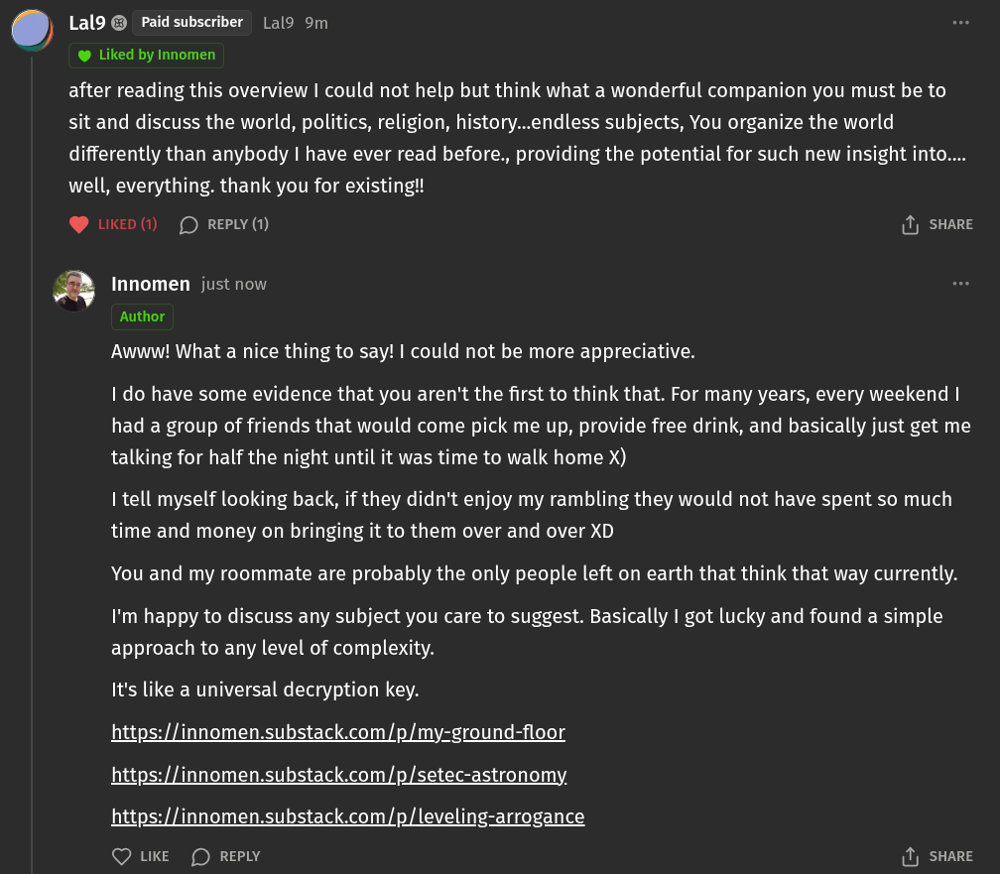

# Public Take transcript

## Machine transcription

.) Lal9 ® Paid subscriber Lal9 9m

@ Liked by Innomen

after reading this overview | could not help but think what a wonderful companion you must be to
sit and discuss the world, politics, religion, history...endless subjects, You organize the world
differently than anybody | have ever read before., providing the potential for such new insight into....
well, everything. thank you for existing!!

@ LIKED (1) (D) REPLY (1) () SHARE

Awww! What a nice thing to say! | could not be more appreciative.

| do have some evidence that you aren't the first to think that. For many years, every weekend |
had a group of friends that would come pick me up, provide free drink, and basically just get me
talking for half the night until it was time to walk home X)

| tell myself looking back, if they didn't enjoy my rambling they would not have spent so much
time and money on bringing it to them over and over XD

You and my roommate are probably the only people left on earth that think that way currently.

I'm happy to discuss any subject you care to suggest. Basically | got lucky and found a simple
approach to any level of complexity.

It's like a universal decryption key.

https://innomen.substack.com/p/my-ground-floor

https://innomen.substack.com/p/setec-astronomy,

https://innomen.substack.com/p/leveling-arrogance

Q LKE (D REPLY (1) SHARE
