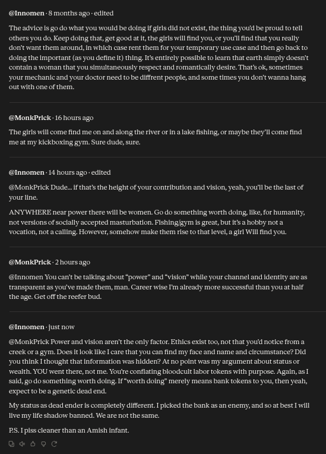

# Public Take transcript

## Machine transcription

@Innomen. 8 months ago - edited.

‘The advice Is go do what you would be dolng I grls id not exist, the thing youd be proud to tell
others you do. Keep doing that, et good at I, the girs will find you, or you'l find that you really.
‘don't want them around, in which case rent them for your temparary tse case and then go back to
dolng the Important (as you define ) thing. It entirely possible to learn that earth simply doesr't
contain a woman that you simultancously respect and romantically desire. That's ok, sometlmes
‘your mechanic and your doctor need to be diffrent people, and some times you dor't wanna hang
‘outwith oneof thern.

@MonkPrick- 16 hoursago

‘The girls will come find me on and along the river orin alake fishing, or maybe they'll come find
‘meat my kickboxing gym. Sure dude, sure.

@Innomen- 14 hours ago- edited

@MonkPrick Dude.. f thatsthe helght of your contribution and vision, yeah, you'l be the last of
yourline.

ANYWHERE near power there will be women. Go do something worth doing, ke, for humanity,
‘ot versions of socially accepted masturbation. Fishing/gym s great, but it a hobby nota
‘vocation, nota calling. However, somehow make them rise to that level, a girl Willfind you.

@MonkPrick- 2 hours ago.

@Innomen You can' be talking about “power” and “vision” while your channel and identity are as
transparent as you've mad them, man. Career wise Im already more successful than you at half
the age. Get offthe reefer bud.

@lnnomen: justnow.

@MonkPrick Power and vision aren't the only factor. Ethics exist oo, not that youd notice froma.
creck ora gym. Does It look ke care that you can find my face and name and clrcumstance? Did
‘ou think I thought that information was hidden? At no point was my argument about tarus or
wealth. YOU went there, not me. You're conflaring bloodcult abor tokens with purpose. Again, as T
sald, go do something worth doing.If “worth doing” merely means bank tokens to you, then yeah,
expect o bea genetic dead end.

My status as dead enderis completely different. I picked the bank as an enemy, and so at best Tvill
live my life shadow banned. We are not the same.

PS.Ipiss cleaner than an Amish Infant
