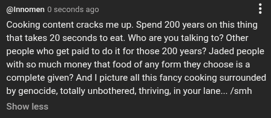

# Public Take transcript

## Machine transcription

@nnomen 0 seconds ago H
Cooking content cracks me up. Spend 200 years on this thing
that takes 20 seconds to eat. Who are you talking to? Other
people who get paid to do it for those 200 years? Jaded people
with so much money that food of any form they choose is a
complete given? And | picture all this fancy cooking surrounded
by genocide, totally unbothered, thriving, in your lane... /smh
Show less
