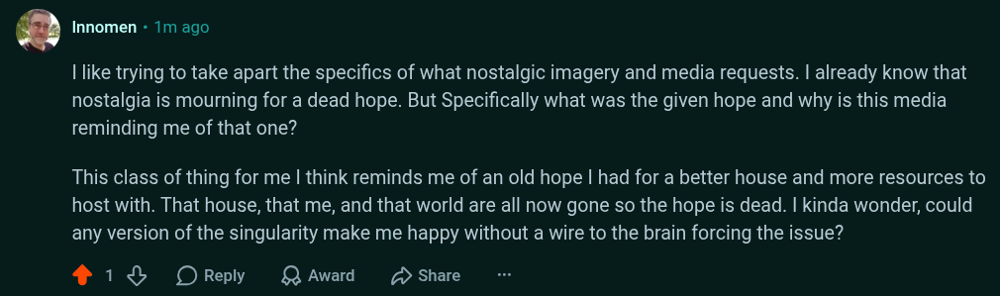

# Public Take transcript

## Machine transcription

' Innomen - 1m ago

| like trying to take apart the specifics of what nostalgic imagery and media requests. | already know that
nostalgia is mourning for a dead hope. But Specifically what was the given hope and why is this media
reminding me of that one?

This class of thing for me | think reminds me of an old hope | had for a better house and more resources to
host with. That house, that me, and that world are all now gone so the hope is dead. | kinda wonder, could
any version of the singularity make me happy without a wire to the brain forcing the issue?

418 OReply QAward D Share
