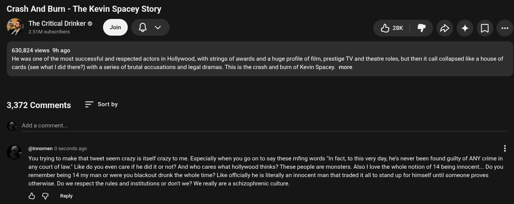

# Public Take transcript

## Machine transcription

Crash And Burn - The Kevin Spacey Story
., The Critical Drinker @
& eomiomiere @Y Q e YYY?Y

630,824 views 9h ago

He was one of the most successful and respected actors in Hollywood, with strings of awards and a huge profile of film, prestige TV and theatre roles, but then it call collapsed like a house of
cards (see what | did there?) with a series of brutal accusations and legal dramas. This is the crash and burn of Kevin Spacey. more

3,372 Comments Sort by

Add a comment.

@nnomen 0 seconds ago

Youtrying to make that tweet seem crazy is itself crazy to me. Especially when you go on to say these mfing words 'In fact, to this very day, he's never been found guilty of ANY crime in
any court of law:" Like do you even care if he did it or not? And who cares what hollywood thinks? These people are monsters. Also | love the whole notion of 14 being innocent... Do you
remember being 14 my man or were you blackout drunk the whole time? Like officially he is literally an innocent man that traded it all to stand up for himself until someone proves
otherwise. Do we respect the rules and institutions or don't we? We really are a schizophrenic culture.

& G Reply
