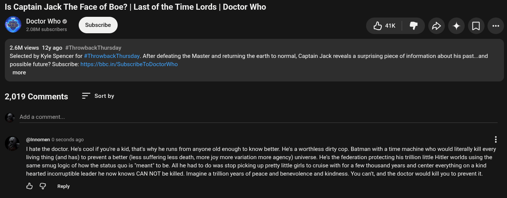

# Public Take transcript

## Machine transcription

Is Captain Jack The Face of Boe? | Last of the Time Lords | Doctor Who

Doctor Who @
@ 2.08M subscribers Hak & S5 4 [

2.6M views 12yago #ThrowbackThursday
Selected by Kyle Spencer for #ThrowbackThursday. After defeating the Master and returing the earth to normal, Captain Jack reveals a surprising piece of information about his past...and
possible future? Subscribe: https:/bbc.in/SubscribeToDoctorWho,

more

2,019 Comments = Sortby
Add a comment.

@nnomen 0 seconds ago H

I hate the doctor. He's cool if you're  kid, that's why he runs from anyone old enough to know better. He's a worthless dirty cop. Batman with a time machine who would literally kill every
living thing (and has) to prevent a better (less suffering less death, more joy more variation more agency) universe. He's the federation protecting his trillion little Hitler worlds using the
same smug logic of how the status quo is ‘meant’ to be. All he had to do was stop picking up pretty little girls to cruise with for a few thousand years and center everything on a kind
hearted incorruptible leader he now knows CAN NOT be killed. Imagine a trllion years of peace and benevolence and kindness. You can't, and the doctor would kil you to prevent it

& G Repy
