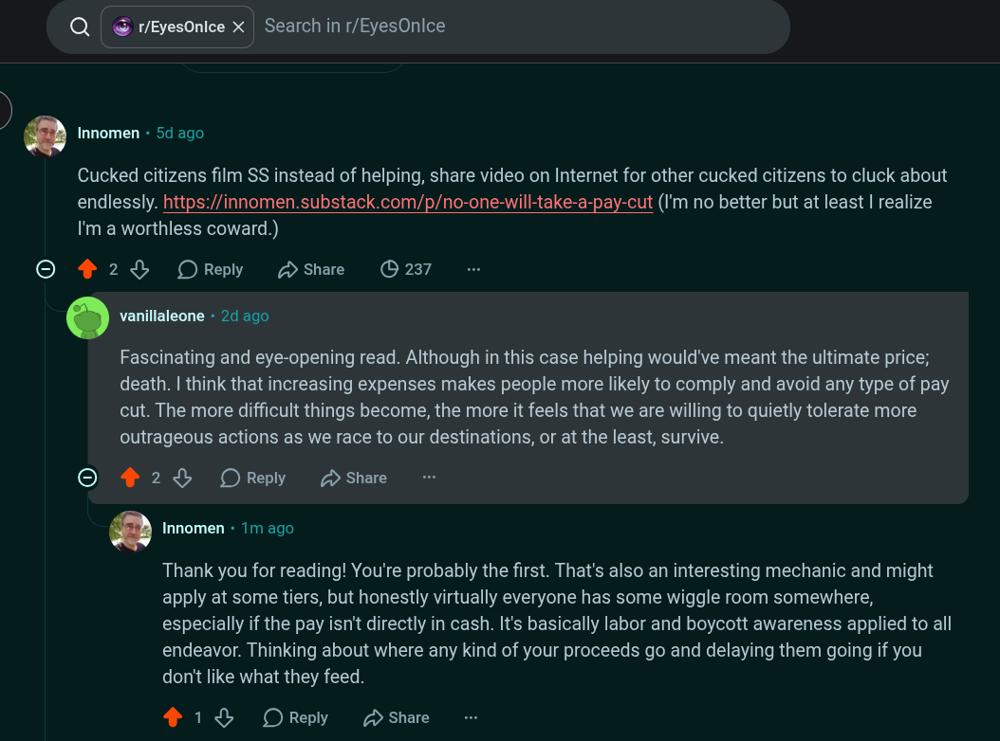

# Public Take transcript

## Machine transcription

Q | & r/EyesOnice X | Search in r/EyesOnice

> ‘ Innomen - 5d ago

Cucked citizens film SS instead of helping, share video on Internet for other cucked citizens to cluck about

endlessly. https://innomen.substack.com/p/no-one-will-take-a-pay-cut (I'm no better but at least | realize
I'm a worthless coward.)

O 428 OReply Hshare (©237

' vanillaleone - 24 ago

Fascinating and eye-opening read. Although in this case helping would've meant the ultimate price;
death. | think that increasing expenses makes people more likely to comply and avoid any type of pay
cut. The more difficult things become, the more it feels that we are willing to quietly tolerate more
outrageous actions as we race to our destinations, or at the least, survive.

© 428 OReply D share

‘ Innomen - 1m ago

Thank you for reading! You're probably the first. That's also an interesting mechanic and might
apply at some tiers, but honestly virtually everyone has some wiggle room somewhere,
especially if the pay isn't directly in cash. It's basically labor and boycott awareness applied to all
endeavor. Thinking about where any kind of your proceeds go and delaying them going if you
don't like what they feed.

218 OReply 2 share
