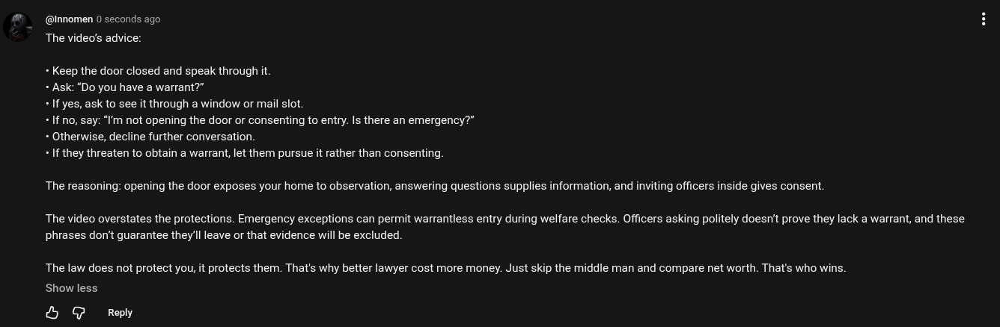

# Public Take transcript

## Machine transcription

@nnomen 0 seconds ago

The video's advice:

+ Keep the door closed and speak through it.

+ Ask: “Do you have a warrant?”

- If yes, ask to see it through a window or mail slot.

 If no, say: “I'm not opening the door or consenting to entry. Is there an emergency?”
- Otherwise, decline further conversation

« If they threaten to obtain a warrant, let them pursue it rather than consenting.

The reasoning: opening the door exposes your home to observation, answering questions supplies information, and inviting officers inside gives consent.

The video overstates the protections. Emergency exceptions can permit warrantless entry during welfare checks. Officers asking politely doesnit prove they lack a warrant, and these
phrases don't guarantee they'll leave o that evidence will be excluded.

The law does not protect you, it protects them. That's why better lawyer cost more money. Just skip the middle man and compare net worth. That's who wins.
Show less

& G Reply
