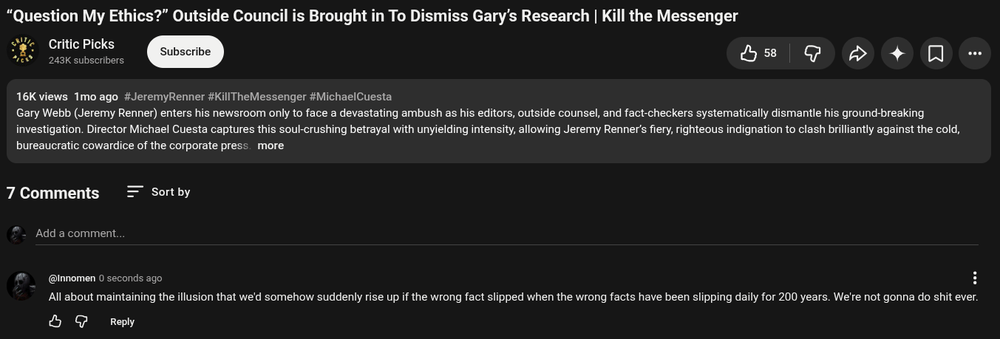

# Public Take transcript

## Machine transcription

“Question My Ethics?” Outside Council is Brought in To Dismiss Gary's Research | Kill the Messenger
<'g’c Critic Picks
e &

16K views Tmo ago #JeremyRenner #KillTheMessenger #MichaelCuesta

¢ &>+ 0 -

Gary Webb (Jeremy Renner) enters his newsroom only to face a devastating ambush as his editors, outside counsel, and fact-checkers systematically dismantle his ground-breaking

investigation. Director Michael Cuesta captures this soul-crushing betrayal with unyielding intensity, allowing Jeremy Renner's fiery, righteous indignation to clash brilliantly against the cold,
bureaucratic cowardice of the corporate press. more

7 Comments = Sortby
Add a comment.

@nnomen 0 seconds ago

All about maintaining the illusion that we'd somehow suddenly rise up if the wrong fact slipped when the wrong facts have been slipping daily for 200 years. We're not gonna do shit ever.

& G Repy
