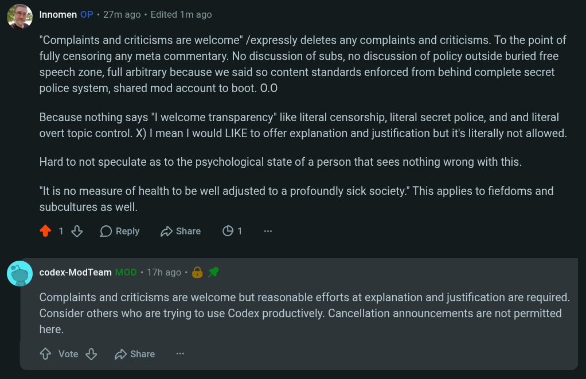

# Public Take transcript

## Machine transcription

Q Innomen OF - 27m ago - Edited 1m ago

"Complaints and criticisms are welcome" /expressly deletes any complaints and criticisms. To the point of
fully censoring any meta commentary. No discussion of subs, no discussion of policy outside buried free
speech zone, full arbitrary because we said so content standards enforced from behind complete secret
police system, shared mod account to boot. 0.0

Because nothing says "l welcome transparency” like literal censorship, literal secret police, and and literal
overt topic control. X) | mean | would LIKE to offer explanation and justification but it's literally not allowed.

Hard to not speculate as to the psychological state of a person that sees nothing wrong with this.

"It is no measure of health to be well adjusted to a profoundly sick society." This applies to fiefdoms and
subcultures as well.

218 OReply Hshae O1

. codex-ModTeam - 17hago - &b

Complaints and criticisms are welcome but reasonable efforts at explanation and justification are required.
Consider others who are trying to use Codex productively. Cancellation announcements are not permitted
here.

4 Vote & D share
