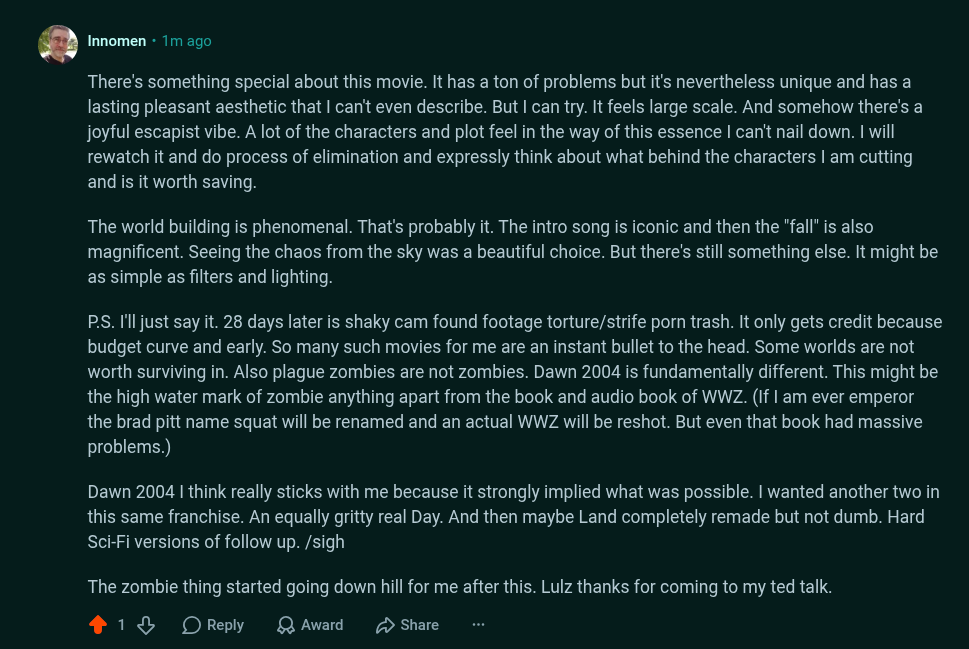

# Public Take transcript

## Machine transcription

. Innomen - 1m ago

There's something special about this movie. It has a ton of problems but it's nevertheless unique and has a
lasting pleasant aesthetic that | can't even describe. But | can try. It feels large scale. And somehow there's a
joyful escapist vibe. A lot of the characters and plot feel in the way of this essence | can't nail down. | will
rewatch it and do process of elimination and expressly think about what behind the characters | am cutting
and is it worth saving.

The world building is phenomenal. That's probably it. The intro song is iconic and then the "fall" is also
magnificent. Seeing the chaos from the sky was a beautiful choice. But there's still something else. It might be
as simple as filters and lighting.

PS. I'ljust say it. 28 days later is shaky cam found footage torture/strife porn trash. It only gets credit because
budget curve and early. So many such movies for me are an instant bullet to the head. Some worlds are not
worth surviving in. Also plague zombies are not zombies. Dawn 2004 is fundamentally different. This might be
the high water mark of zombie anything apart from the book and audio book of WWZ. (If | am ever emperor
the brad pitt name squat will be renamed and an actual WWZ will be reshot. But even that book had massive
problems.)

Dawn 2004 | think really sticks with me because it strongly implied what was possible. | wanted another two in
this same franchise. An equally gritty real Day. And then maybe Land completely remade but not dumb. Hard
Sci-Fi versions of follow up. /sigh

The zombie thing started going down hill for me after this. Lulz thanks for coming to my ted talk.

418 OReply QAwad 2 Share
