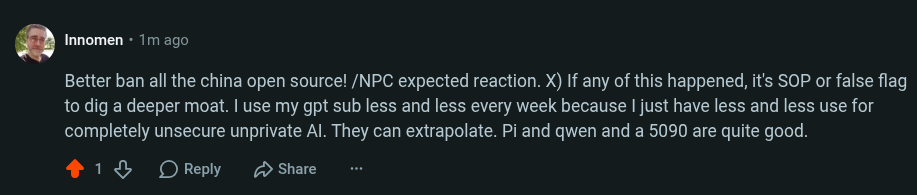

# Public Take transcript

## Machine transcription

innomen - 1m ago

Better ban all the china open source! /NPC expected reaction. X) If any of this happened, it's SOP or false flag
to dig a deeper moat. | use my gpt sub less and less every week because | just have less and less use for
completely unsecure unprivate Al. They can extrapolate. Pi and gwen and a 5090 are quite good.

4138 OReply 2 Share
