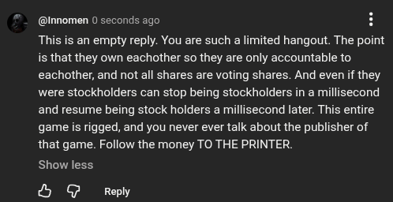

# Public Take transcript

## Machine transcription

(@Innomen 0 seconds ago H
This is an empty reply. You are such a limited hangout. The point
is that they own eachother so they are only accountable to
eachother, and not all shares are voting shares. And even if they
were stockholders can stop being stockholders in a millisecond
and resume being stock holders a millisecond later. This entire
game s rigged, and you never ever talk about the publisher of
that game. Follow the money TO THE PRINTER

Show less

& @ Reply
