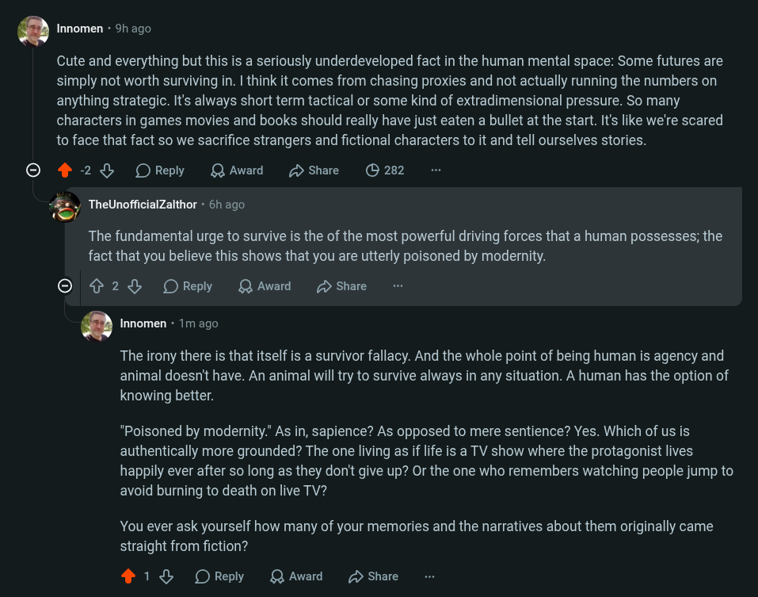

# Public Take transcript

## Machine transcription

’ Innomen - 9h ago

Cute and everything but this is a seriously underdeveloped fact in the human mental space: Some futures are
simply not worth surviving in. | think it comes from chasing proxies and not actually running the numbers on
anything strategic. It's always short term tactical or some kind of extradimensional pressure. So many
characters in games movies and books should really have just eaten a bullet at the start. It's like we're scared
to face that fact so we sacrifice strangers and fictional characters to it and tell ourselves stories.

© 4 28% OReply QAward DShare (282

<g7 TheUnofficialZalthor - 6h ago

The fundamental urge to survive is the of the most powerful driving forces that a human possesses; the
fact that you believe this shows that you are utterly poisoned by modernity.

O ¢ 28 OReply QAward D Share

’ Innomen - 1m ago

The irony there is that itself is a survivor fallacy. And the whole point of being human is agency and
animal doesn't have. An animal will try to survive always in any situation. A human has the option of
knowing better.

"Poisoned by modernity." As in, sapience? As opposed to mere sentience? Yes. Which of us is
authentically more grounded? The one living as if life is a TV show where the protagonist lives

happily ever after so long as they don't give up? Or the one who remembers watching people jump to
avoid burning to death on live TV?

You ever ask yourself how many of your memories and the narratives about them originally came
straight from fiction?

218 OReply QAwad 2 Share
