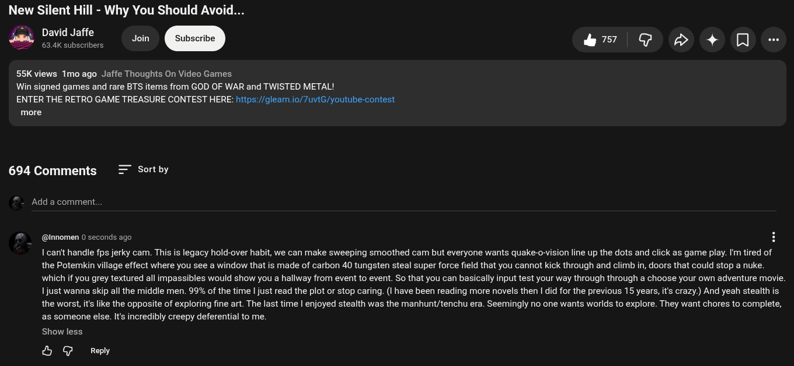

# Public Take transcript

## Machine transcription

New Silent Hill - Why You Should Avoid...

David Jaffe q
e Jom & G S 4+ O -

55K views Tmo ago Jaffe Thoughts On Video Games

Win signed games and rare BTS items from GOD OF WAR and TWISTED METAL!

ENTER THE RETRO GAME TREASURE CONTEST HERE: hitps://gleam.io/7uviG/youtube-contest
more

694 Comments Sort by

Add a comment.

@Innomen 0 seconds ago H

I canit handle fps jerky cam. This is legacy hold-over habit, we can make sweeping smoothed cam but everyone wants quake-o-vision line up the dots and click as game play. I'm tired of
the Potemkin village effect where you see a window that is made of carbon 40 tungsten steal super force field that you cannot kick through and climb i, doors that could stop a nuke.
which if you grey textured all impassibles would show you a hallway from event to event. So that you can basically input test your way through through a choose your own adventure movie.
1just wanna skip all the middle men. 99% of the time | just read the plot or stop caring. (I have been reading more novels then | did for the previous 15 years, it's crazy.) And yeah stealth is
the worst, it like the opposite of exploring fine art. The last time | enjoyed stealth was the manhunt/tenchu era. Seemingly no one wants worlds to explore. They want chores to complete,
as someone else. s incredibly creepy deferential to me.

Show less

& G Reply
