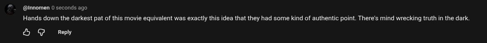

# Public Take transcript

## Machine transcription

@nnomen 0 seconds ago

Hands down the darkest pat of this movie equivalent was exactly this idea that they had some kind of authentic point. There's mind wrecking truth in the dark.

& GG Reply
