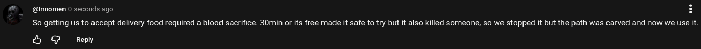

# Public Take transcript

## Machine transcription

@ @innomen 0 seconds ago H

So getting us to accept delivery food required a blood sacrifice. 30min or its free made it safe to try but it also killed someone, so we stopped it but the path was carved and now we use it.

& G Reply
