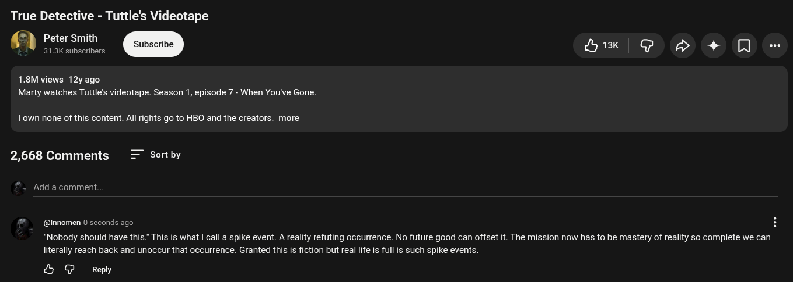

# Public Take transcript

## Machine transcription

True Detective - Tuttle's Videotape
Peter Smith
‘ " 31.3K subscribers Hix | G o 4+ 0O

1.8M views 12y ago
Marty watches Tuttle's videotape. Season 1, episode 7 - When You've Gone.

1 own none of this content. All rights go to HBO and the creators. more

2,668 Comments = Sortby
Add a comment.

@nnomen 0 seconds ago

*Nobody should have this." This is what | call a spike event. A reality refuting occurrence. No future good can offset it. The mission now has to be mastery of reality so complete we can
literally reach back and unoccur that occurrence. Granted this is fiction but real lie i full is such spike events.

& G Repy
