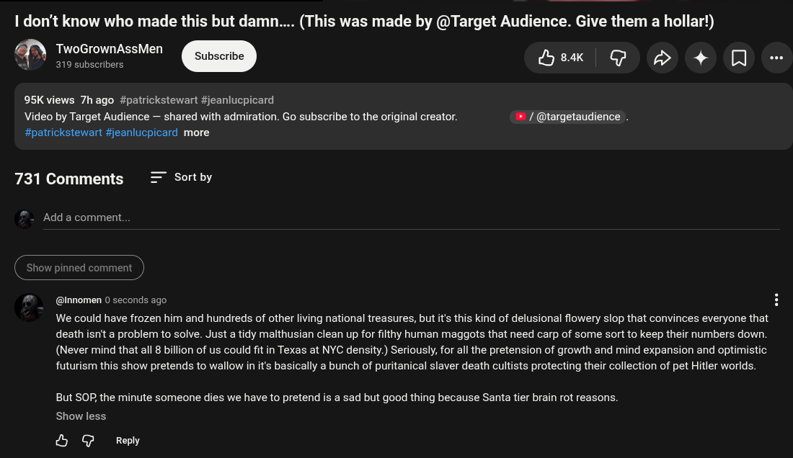

# Public Take transcript

## Machine transcription

1 don’t know who made this but damn.... (This was made by @Target Audience. Give them a hollar!)

Lo @ A 4+ O -

TwoGrownAssMen
319 subscribers

95K views 7hago #patrickstewart #jeanlucpicard
Video by Target Audience — shared with admiration. Go subscribe to the original creator. » / @targetaudience .
#patrickstewart #jeanlucpicard more

731 Comments Sort by

Add a comment.

inned comment

@nnomen 0 seconds ago H

We could have frozen him and hundreds of other living national treasures, but t's this kind of delusional flowery slop that convinces everyone that
death isn't a problem to solve. Just a tidy malthusian clean p for fithy human maggots that need carp of some sort to keep their numbers down.

(Never mind that all 8 billion of us could fit in Texas at NYC density.) Seriously, for all the pretension of growth and mind expansion and optimistic
futurism this show pretends to wallow in it's basically a bunch of puritanical slaver death cultists protecting their collection of pet Hitler worlds.

But SO, the minute someone dies we have to pretend is a sad but good thing because Santa tier brain rot reasons.
Show less

OH G Reply
