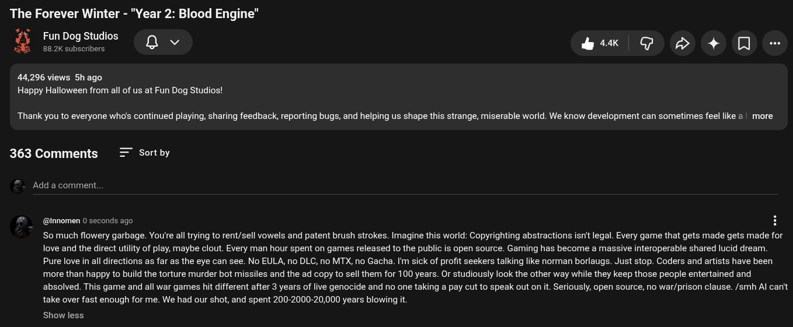

# Public Take transcript

## Machine transcription

The Forever Winter - "Year 2: Blood Engine"

e n
7% FunDog Studios
»,jé 88.2K subscribers Q e

& Q@ D 4+ [Q -

44,296 views 5hago
Happy Halloween from all of us at Fun Dog Studios!

Thank you to everyone who's continued playing, sharing feedback, reporting bugs, and helping us shape this strange, miserable world. We know development can sometimes feel like @ | more

363 Comments = Sortby

Add a comment.

@nnomen 0 seconds ago H

So much flowery garbage. You're all trying to rent/sell vowels and patent brush strokes. Imagine this world: Copyrighting abstractions isn't legal. Every game that gets made gets made for
love and the direct utility of play, maybe clout. Every man hour spent on games released to the public is open source. Gaming has become a massive interoperable shared lucid dream.
Pure love in all directions as far as the eye can see. No EULA, no DLC, no MTX, no Gacha. I'm sick of profit seekers talking like norman borlaugs. Just stop. Coders and artists have been
more than happy to build the torture murder bot missiles and the ad copy to sell them for 100 years. Or studiously look the other way while they keep those people entertained and
absolved. This game and all war games hit different after 3 years of live genocide and no one taking a pay cut to speak out on it. Seriously, open source, no war/prison clause. /smh Al can't
take over fast enough for me. We had our shot, and spent 200-2000-20,000 years blowing it.

Show less
