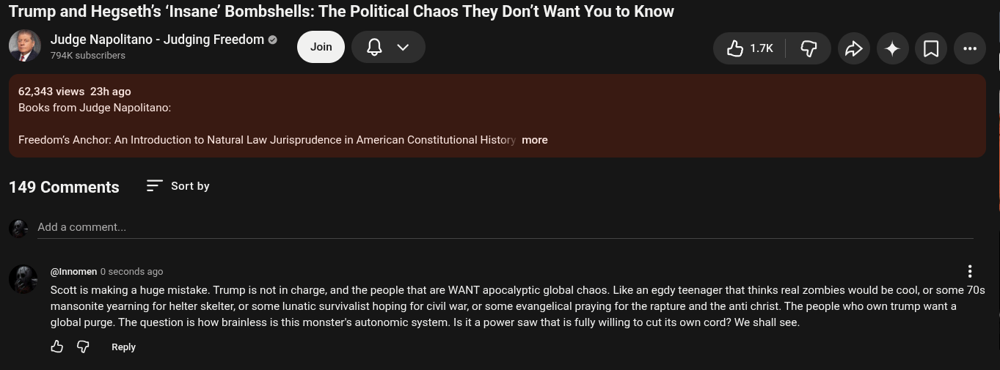

# Public Take transcript

## Machine transcription

Trump and Hegseth's ‘Insane’ Bombshells: The Political Chaos They Don't Want You to Know
Judge Napolitano - Judging Freedom &
e o @ Qv Hik G D 4+ [ -

62,343 views 23hago
Books from Judge Napolitano:

Freedom’s Anchor: An Introduction to Natural Law Jurisprudence in American Constitutional Histor; more

149 Comments Sort by

Add a comment.

@nnomen 0 seconds ago H

Scott is making a huge mistake. Trump is not in charge, and the people that are WANT apocalyptic global chaos. Like an egdy teenager that thinks real zombies would be cool, or some 70s
mansonite yearning for helter skelter, or some lunatic survivalist hoping for civil war, or some evangelical praying for the rapture and the anti christ. The people who own trump want a
global purge. The question is how brainless is this monster's autonomic system. Is it a power saw that is fully willing to cut its own cord? We shall see.

& G Repy
