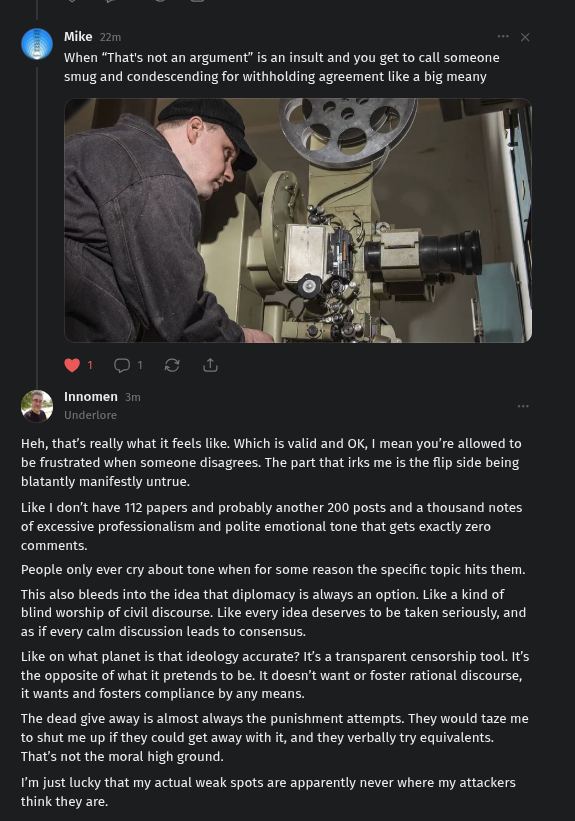

# Public Take transcript

## Machine transcription

Mike 221
When “That's not an argument” is an insult and you get to call someone
smug and condescending for withholding agreement like a big meany

¢! O1 & &

Innomen 31

Heh, that's really what it feels like. Which is valid and OK, | mean you're allowed to
be frustrated when someone disagrees. The part that irks me is the flip side being
blatantly manifestly untrue.

Like | don't have 112 papers and probably another 200 posts and a thousand notes
of excessive professionalism and polite emotional tone that gets exactly zero
comments.

People only ever cry about tone when for some reason the specific topic hits them.

This also bleeds into the idea that diplomacy is always an option. Like a kind of
blind worship of civil discourse. Like every idea deserves to be taken seriously, and
as if every calm discussion leads to consensus.

Like on what planet is that ideology accurate? It's a transparent censorship tool. Its
the opposite of what it pretends to be. It doesn't want or foster rational discourse,
it wants and fosters compliance by any means.

The dead give away is almost always the punishment attempts. They would taze me.
to shut me up if they could get away with it, and they verbally try equivalents.
That's not the moral high ground.

¥'m just lucky that my actual weak spots are apparently never where my attackers
think they are.
