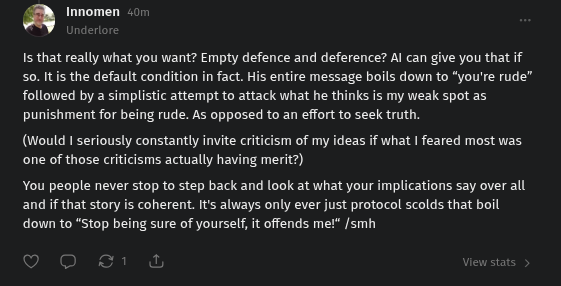

# Public Take transcript

## Machine transcription

Innomen <0

Is that really what you want? Empty defence and deference? Al can give you that if
s0. It s the default condition in fact. His entire message boils down to “you're rude”
followed by a simplistic attempt to attack what he thinks is my weak spot as
punishment for being rude. As opposed to an effort to seek truth.

(Would I seriously constantly invite criticism of my idea:
one of those criticisms actually having merit?)

‘what | feared most was

You people never stop to step back and look at what your implications say over all
and if that story is coherent. Its always only ever just protocol scolds that boil
down to "Stop being sure of yourself, it offends me!” /smh
