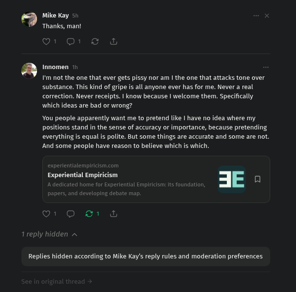

# Public Take transcript

## Machine transcription

Mike Kay
Thanks, man!

a Innomen 11

I'm not the one that ever gets pissy nor am | the one that attacks tone over
substance. This kind of gripe is all anyone ever has for me. Never a real.
correction. Never receipts. | know because | welcome them. Specifically.
which ideas are bad or wrong?

You people apparently want me to pretend like | have no idea where my
positions stand in the sense of accuracy or importance, because pretending
everything is equal is polite. But some things are accurate and some are not.
And some people have reason to believe which is which.

xperientialempiricism.com
Experiential Empi

Replies hidden according to Mike Kay's reply rules and moderation preferences
