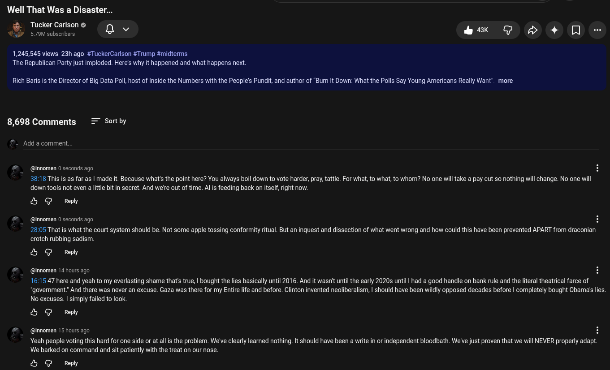

# Public Take transcript

## Machine transcription

Well That Was a Disaster...
Tucker Carl
“6 ucker Carlson @ Q v ‘ 43K q d) + D -

47 579M subscribers

1,245,545 views 23h ago #TuckerCarlson #Trump #midterms
The Republican Party just imploded. Here's why it happened and what happens next

Rich Baris is the Director of Big Data Poll, host of Inside the Numbers with the People’s Pundit, and author of “Burn It Down: What the Polls Say Young Americans Really Want" more

8,698 Comments = Sortby

- Add a comment.

@ @nnomen 0 seconds ago

38:18 This s as far as | made it. Because what's the point here? You always boil down to vote harder, pray, tattle. For what, to what, to whom? No one willtake a pay cut so nothing will change. No one wil
down tools not even a little bit in secret. And we're out of time. Al is feeding back on itself, right now

& G Reply

#  @innomen 0 seconds ago H
28:05 That is what the court system should be. Not some apple tossing conformity ritual. But an inquest and dissection of what went wrong and how could this have been prevented APART from draconian

crotch rubbing sadism.

& G Reply

@ @innomen 14 hours ago
16:15 47 here and yeah to my everlasting shame that's true, | bought the lies basically until 2016. And it wasnit untilthe early 2020s until | had a good handle on bank rule and the literal theatrical farce of
"government.” And there was never an excuse. Gaza was there for my Entire life and before. Clinton invented neoliberalism, | should have been wildly opposed decades before | completely bought Obamas lies.
No excuses. | simply failed to ook

& G Reply

@ @innomen 15 hours ago H
Yeah people voting this hard for one side or at all is the problem. We've clearly leamed nothing. It should have been a write in or independent bloodbath. We've just proven that we will NEVER properly adapt.

We barked on command and sit patiently with the treat on our nose.

& @ Reply
