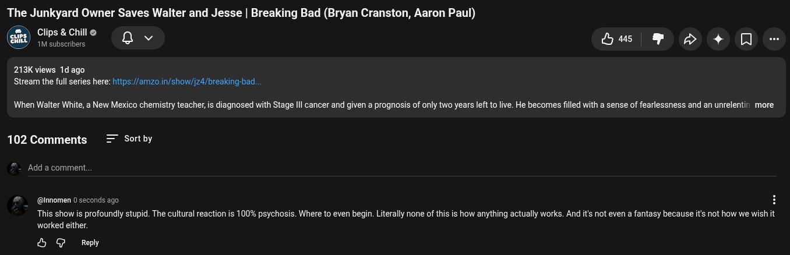

# Public Take transcript

## Machine transcription

The Junkyard Owner Saves Walter and Jesse | Breaking Bad (Bryan Cranston, Aaron Paul)

(m) Clips & Chill Q ©

G8Y 1M subscribers

Lus ® D> 4 O -

213K views 1d ago
Stream the full series here: htps://amzo.in/show/jz4/breaking-bad...

When Walter White, a New Mexico chemistry teacher is diagnosed with Stage Ill cancer and given a prognosis of only two years left o live. He becomes filled with a sense of fearlessness and an unrelentin more

102 Comments = Sortby

Add a comment.

(@Innomen 0 seconds ago H

This show is profoundly stupid. The cultural reaction is 100% psychosis. Where to even begin. Literally none of this is how anything actually works. And it not even a fantasy because its not how we wishit
worked either.

& G Reply
