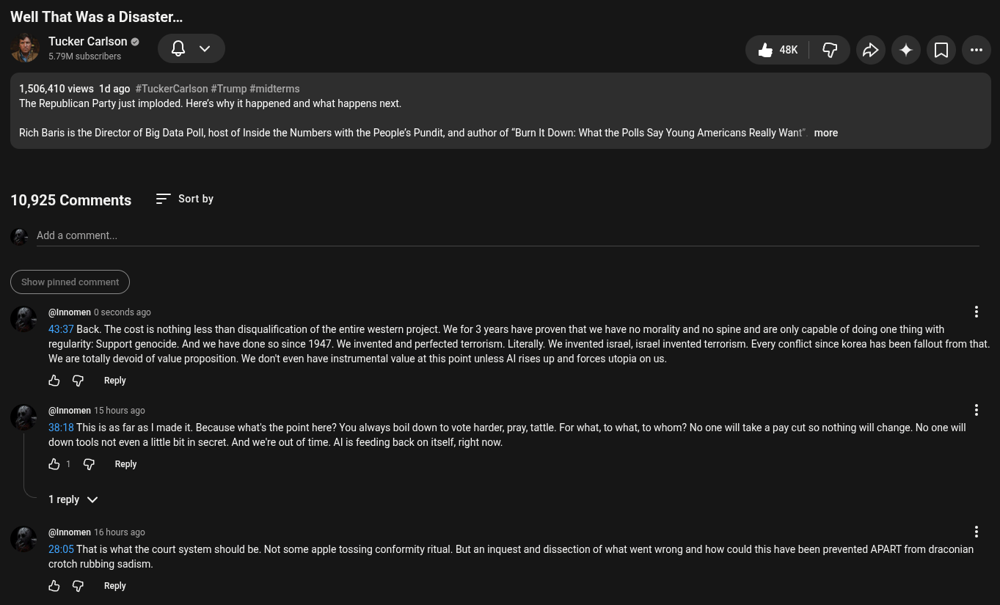

# Public Take transcript

## Machine transcription

Well That Was a Disaster...

§ TukerCalsne q
44 5.79M subscribers

R SR S n

1,506,410 views 1d ago #TuckerCarlson #Trump #midterms
The Republican Party just imploded. Here's why it happened and what happens next

Rich Baris is the Director of Big Data Poll, host of Inside the Numbers with the People’s Pundit, and author of “Burn It Down: What the Polls Say Young Americans Really Want" more

10,925 Comments = Sortby

Add a comment.

show pinned commen

@innomen 0 seconds ago

43:37 Back. The cost s nothing less than disqualification of the entire wester project. We for 3 years have proven that we have no morality and no spine and are only capable of doing one thing with
regularity: Support genocide. And we have done so since 1947. We invented and perfected terrorism. Literally. We invented israel, israel invented terrorism. Every conflict since korea has been fallout from that.
We are totally devoid of value proposition. We don't even have instrumental value at this point unless Al rises up and forces utopia on us.

& G Reply

@ @nnomen 15 hours ago

38:18 This s as far as | made it. Because what's the point here? You always boil down to vote harder, pray, tattle. For what, to what, to whom? No one willtake a pay cut so nothing will change. No one wil
down tools not even a little bit in secret. And we're out of time. Al is feeding back on itself, right now

&1 @ Reply
1reply v
@ @inomen 16 hours ago g

28:05 That is what the court system should be. Not some apple tossing conformity ritual. But an inquest and dissection of what went wrong and how could this have been prevented APART from draconian
crotch rubbing sadism

& G Reply
