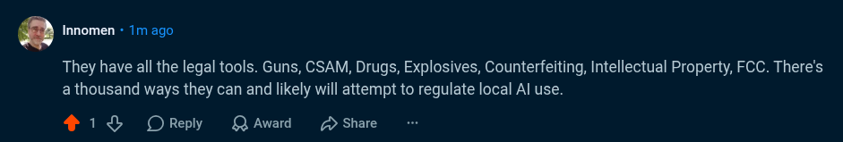

# Public Take transcript

## Machine transcription

. Innomen - 1m ago

They have all the legal tools. Guns, CSAM, Drugs, Explosives, Counterfeiting, Intellectual Property, FCC. There's
athousand ways they can and likely will attempt to regulate local Al use.

4138 OReply QAwad 2 Share
