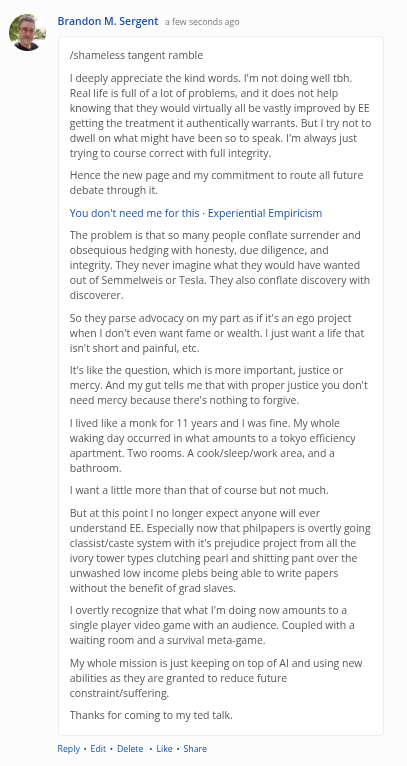

# Public Take transcript

## Machine transcription

‘ Brandon M. Sergent e sconcc 50

Jshameless tangent ramble:

1 deeply appreciate the kind words. ' not doing wellth
Real lfe i full of a ot of problems, and it does not help.
Knowing that they would virtually al e vastly improved by EE
getting the treatment it authenticallywarrants. But |ty not to
well on what might have been 50 to speak.I'm always Just
trying to course correct with fulintegrty.

Hence the new page and my commitment o route allfuture
debate through .

You don't need me for this - Experiential Empiicism

The problem i that so many people confate surrender and
obsequiovs hedging with honesty,due dilgence, and
ntegriy. They never imagine what they would have wanted
out of Semmelwes or Tesia, They alsa confate discovery with
discoverer.

Sothey parse advocacy on my part as It's an ego project
when | don't even wank fame or wealth.  just want a e that
snitshort and painful, etc.

1t ke the question, which is more important, ustice or
mercy. And my gut tells me that with proper justice you dorft
need mercy because there's nothing to forgie.

1iived Tike a monk for 11 years and I was fine. My whole
waking day occurred in what amounts to a tokyo effciency.
apartment. Two rooms. A cook/sieep/work area, and a
bathroom,

I want altie more than that of caurse bt not much.

But at this point | no langer expect anyone wil ever
understand EE. Especially now that philpapers is overtly going
classisticaste system with i's prejudice project from althe.
Wory tower types clutching pearl and shitting pant over the
unwashed low income plebs being able to write papers
without the benefitof grad slaves.

1 overtly recognize that what Im doing now amounts to @
single player video game with an audience. Coupled with a
waiting room and a survival meta-game.

My whole mission i ust keeping on top of Al and using new
abilties as they are granted ta reduce future:
constraint/suffering.

Thanks for coming to my ted tak.

Reply « Edt - Delete - i - Share
