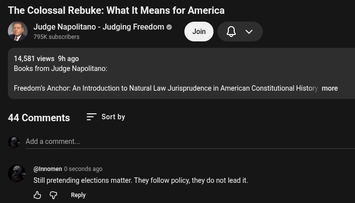

# Public Take transcript

## Machine transcription

The Colossal Rebuke: What It Means for America
Judge Napolitano - Judging Freedom & a v
795K subscribers

14,581 views Shago
Books from Judge Napolitano:

Freedom's Anchor: An Introduction to Natural Law Jurisprudence in American Constitutional History more

44 Comments Sort by

Add a comment.

@ @Innomen 0 seconds ago
Still pretending elections matter. They follow policy, they do not lead it

&L @ Reply
