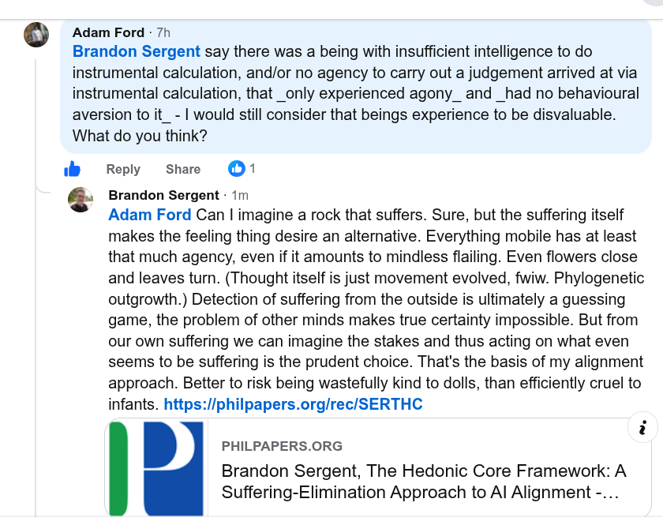

# Public Take transcript

## Machine transcription

Adam Ford - 7h

Brandon Sergent say there was a being with insufficient intelligence to do
instrumental calculation, and/or no agency to carry out a judgement arrived at via
instrumental calculation, that _only experienced agony_ and _had no behavioural
aversion to it_ - | would still consider that beings experience to be disvaluable.
What do you think?

W

£ 3

Reply share @1

Brandon Sergent - 1m

Adam Ford Can | imagine a rock that suffers. Sure, but the suffering itself
makes the feeling thing desire an alternative. Everything mobile has at least
that much agency, even if it amounts to mindless flailing. Even flowers close
and leaves turn. (Thought itself is just movement evolved, fwiw. Phylogenetic
outgrowth.) Detection of suffering from the outside is ultimately a guessing
game, the problem of other minds makes true certainty impossible. But from
our own suffering we can imagine the stakes and thus acting on what even
seems to be suffering is the prudent choice. That's the basis of my alignment
approach. Better to risk being wastefully kind to dolls, than efficiently cruel to
infants. https://philpapers.org/rec/SERTHC

i
. PHILPAPERS.ORG

Brandon Sergent, The Hedonic Core Framework: A
Suffering-Elimination Approach to Al Alignment -...
