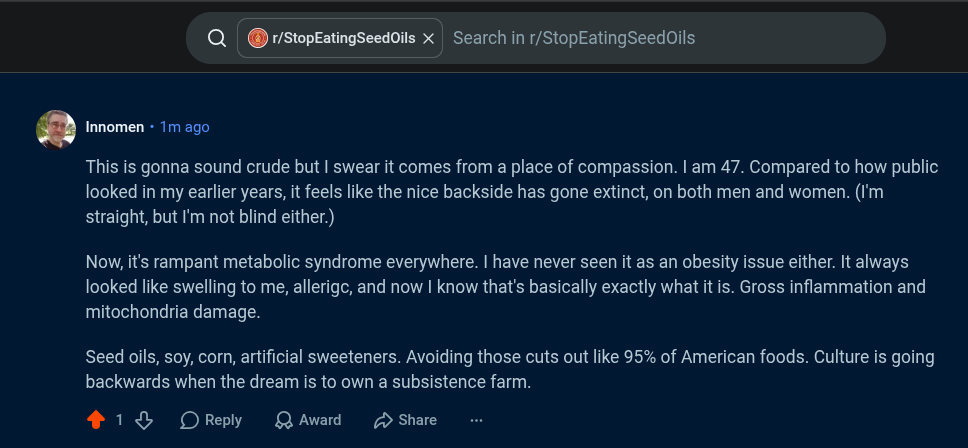

# Public Take transcript

## Machine transcription

Q| @ r/StopEatingSeedoils X | Search in r/StopEatingSeedoils

. Innomen - 1m ago

This is gonna sound crude but | swear it comes from a place of compassion. | am 47. Compared to how public
looked in my earlier years, it feels like the nice backside has gone extinct, on both men and women. (I'm
straight, but I'm not blind either.)

Now, it's rampant metabolic syndrome everywhere. | have never seen it as an obesity issue either. It always
looked like swelling to me, allerigc, and now | know that's basically exactly what it is. Gross inflammation and
mitochondria damage.

Seed oils, soy, corn, artificial sweeteners. Avoiding those cuts out like 95% of American foods. Culture is going
backwards when the dream is to own a subsistence farm.

418 OReply QAwad 2 Share
