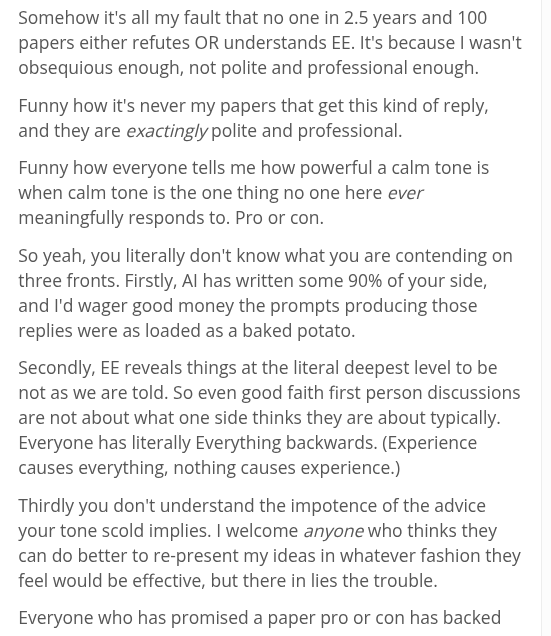

# Public Take transcript

## Machine transcription

Somehow it's all my fault that no one in 2.5 years and 100
papers either refutes OR understands EE. It's because | wasn't
obsequious enough, not polite and professional enough.

Funny how it's never my papers that get this kind of reply,
and they are exactingly polite and professional.

Funny how everyone tells me how powerful a calm tone is
when calm tone is the one thing no one here ever
meaningfully responds to. Pro or con.

So yeah, you literally don't know what you are contending on
three fronts. Firstly, Al has written some 90% of your side,
and I'd wager good money the prompts producing those
replies were as loaded as a baked potato.

Secondly, EE reveals things at the literal deepest level to be
not as we are told. So even good faith first person discussions
are not about what one side thinks they are about typically.
Everyone has literally Everything backwards. (Experience
causes everything, nothing causes experience.)

Thirdly you don't understand the impotence of the advice
your tone scold implies. | welcome anyone who thinks they
can do better to re-present my ideas in whatever fashion they
feel would be effective, but there in lies the trouble.

Everyone who has promised a paper pro or con has backed
