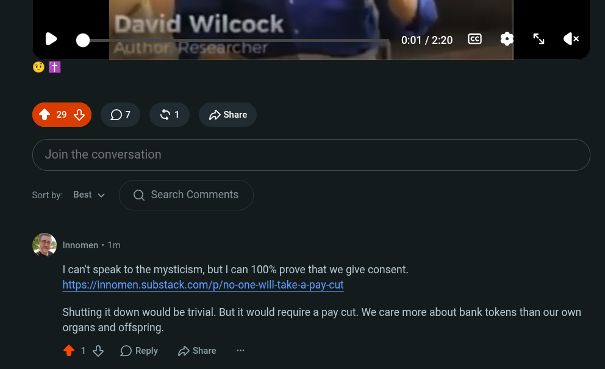

# Public Take transcript

## Machine transcription

- AU |
| N !‘]u-lm{ ‘10:0112;20 @ q N gx

Join the conversation

Sortby: Best v Q Search Comments

| can't speak to the mysticism, but | can 100% prove that we give consent.
https://innomen.substack.com/p/no-one-will-take-a-pay-cut

Shutting it down would be trivial. But it would require a pay cut. We care more about bank tokens than our own
organs and offspring.

418 OReply D Share
