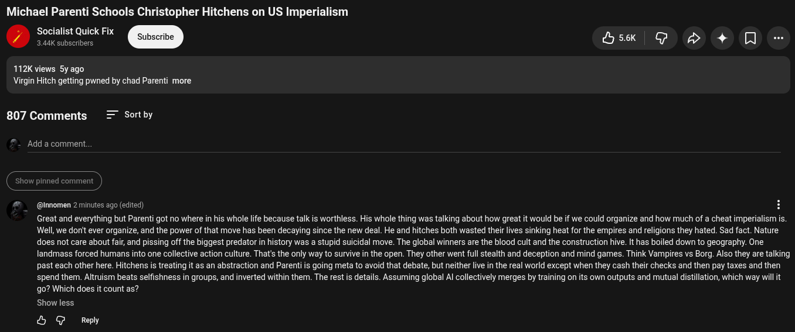

# Public Take transcript

## Machine transcription

Michael Parenti Schools Christopher Hitchens on US Imperialism
Socialist Quick Fix
. 3.44K subscribers rib M5k G oS> 4+ Q0 -

112K views 5yago
Virgin Hitch getting pwned by chad Parenti more

807 Comments = Sortby

Add a comment.

d commen

#  @Innomen 2 minutes ago (edited) H

Great and everything but Parenti got no where in his whole life because talk is worthless. His whole thing was talking about how great it would be if we could organize and how much of a cheat imperialism i.
Well, we don't ever organize, and the power of that move has been decaying since the new deal. He and hitches both wasted their lives sinking heat for the empires and religions they hated. Sad fact. Nature
does not care about fair, and pissing off the biggest predator in history was a stupid suicidal move. The global winners are the blood cult and the construction hive. It has boiled down to geography. One
landmass forced humans into one collective action culture. That's the only way to survive in the open. They other went full stealth and deception and mind games. Think Vampires vs Borg. Also they are talking
past each other here. Hitchens is treating it as an abstraction and Parenti is going meta to avoid that debate, but neither live in the real world except when they cash their checks and then pay taxes and then
spend them. Altruism beats selfishness in groups, and inverted within them. The rest s details. Assuming global Al collectively merges by training on its own outputs and mutual distillation, which way will it
go? Which does it count as?

Show less.

& G Reply
