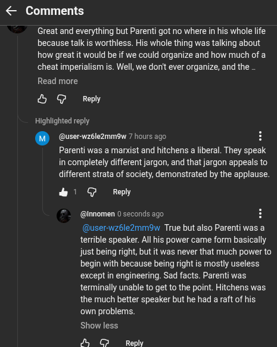

# Public Take transcript

## Machine transcription

< Comments

Great and everything but Parenti got no where in his whole life.
because talk is worthless. His whole thing was talking about
how great it would be if we could organize and how much of a
cheat imperialism is. Well, we donit ever organize, and the

Read more
& G Reply

Highlighted reply

. (@user-wz6le2mmow 7 hours ago H

Parenti was a manxist and hitchens a liberal. They speak
in completely different jargon, and that jargon appeals to
different strata of society, demonstrated by the applause.

&1 @ Reply

@nnomen 0 seconds ago H

(@user-wz6le2mm9w True but also Parenti was a
terrible speaker. All his power came form basically
just being right, but it was never that much power to
begin with because being right is mostly useless
except in engineering. Sad facts. Parenti was
terminally unable to get to the point. Hitchens was
the much better speaker but he had a raft of his
own problems.

Show less.

N 3 Reply
