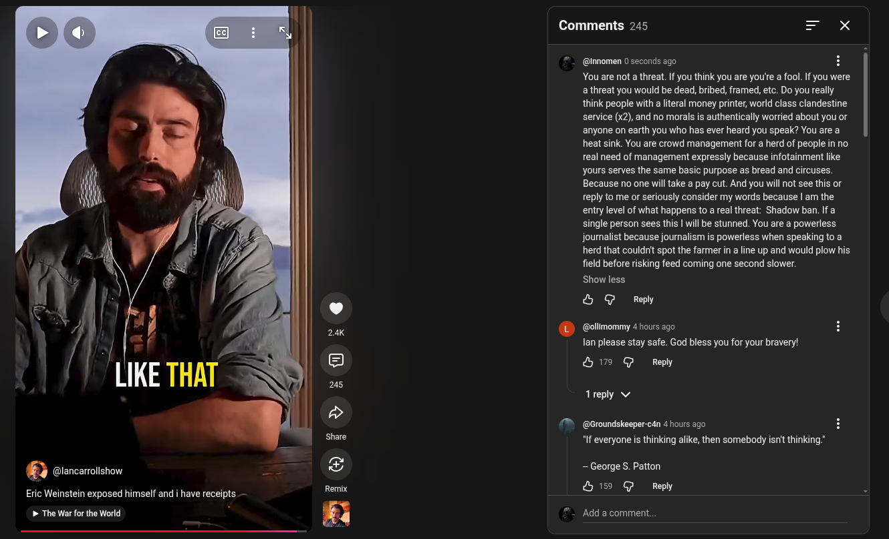

# Public Take transcript

## Machine transcription

Eric Weinstein exposed himself and i have receipts

» The War for the World

Comments 245

. @ollimommy 4 hours ago

(@Innomen 0 seconds ago H
You are not a threat. If you think you are youre a fool. If you were
a threat you would be dead, bribed, framed, etc. Do you really
think people with a literal money printer, world class clandestine
senvice (x2), and no morals is authentically worried about you or
anyone on earth you who has ever heard you speak? You are a
heat sink. You are crowd management for a herd of people in no
real need of management expressly because infotainment like
yours serves the same basic purpose as bread and circuses.
Because no one willtake a pay cut. And you will not see this or
reply to me or seriously consider my words because | am the
entry level of what happens to a real threat: Shadow ban. If a
single person sees this | will be stunned. You are a powerless
journalist because journalism is powerless when speaking to a
herd that couldn't spot the farmer in a line up and would plow his
field before risking feed coming one second slower.

Show less.

O @ Reply

lan please stay safe. God bless you for your bravery!

&0 G Reply
1reply v

(@Groundskeeper-cdn 4 hours ago
*If everyone s thinking alike, then somebody isrit thinking."

~George S. Patton

& @ ey

- Add a comment.
