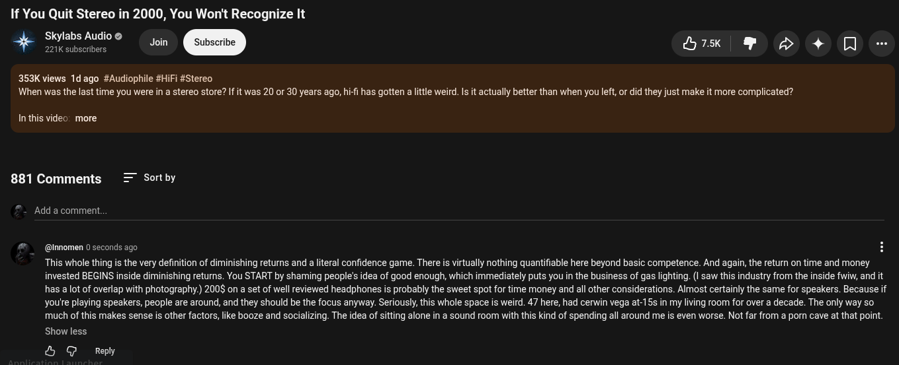

# Public Take transcript

## Machine transcription

If You Quit Stereo in 2000, You Won't Recognize It
Skylabs Audio © .
wkyK subscribers Join Hrsk &S 4 [ -

353K views 1dago #Audiophile #HiFi #Stereo
When was the last time you were in a stereo store? I it was 20 or 30 years ago, hi-i has gotten a lttle weird. Is it actually better than when you left or did they just make it more complicated?

In this video more

881 Comments = Sortby

Add a comment.

@innomen 0 seconds ago

This whole thing is the very definition of diminishing returs and a literal confidence game. There is virtually nothing quantifiable here beyond basic competence. And again, the return on time and money
invested BEGINS inside diminishing returs. You START by shaming people’s idea of good enough, which immediately puts you in the business of gas lighting. (I saw this industry from the inside fwiw, and it
has a lot of overlap with photography.) 2008 on a set of well reviewed headphones is probably the sweet spot for time money and all other considerations. Almost certainly the same for speakers. Because if
you'e playing speakers, people are around, and they should be the focus anyway. Seriously, this whole space is weird. 47 here, had cerwin vega at-15s in my living room for over a decade. The only way so

much of this makes sense is other factors, like booze and socializing. The idea of sitting alone in a sound room with this kind of spending all around me is even worse. Not far from a porn cave at that point.
Show less

& G Reply
