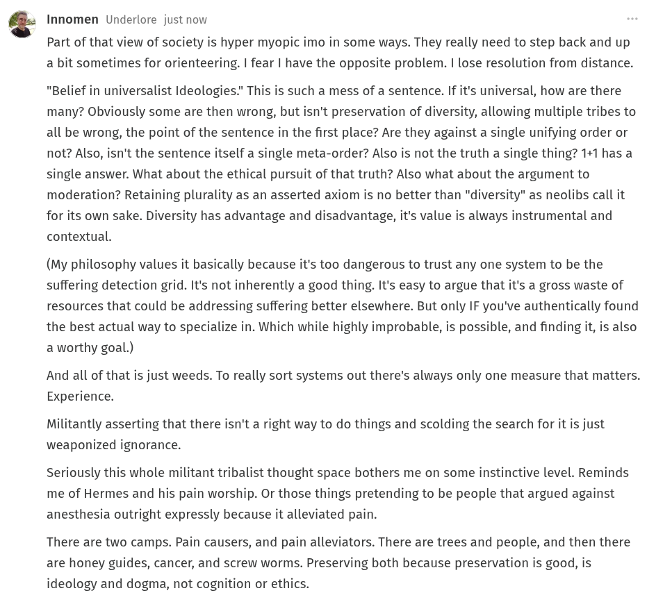

# Public Take transcript

## Machine transcription

Innomen Underlore just now

Part of that view of society is hyper myopic imo in some ways. They really need to step back and up
a bit sometimes for orienteering. | fear | have the opposite problem. | lose resolution from distance.

"Belief in universalist Ideologies." This is such a mess of a sentence. If it's universal, how are there
many? Obviously some are then wrong, but isn't preservation of diversity, allowing multiple tribes to
all be wrong, the point of the sentence in the first place? Are they against a single unifying order or
not? Also, isn't the sentence itself a single meta-order? Also is not the truth a single thing? 1+1 has a
single answer. What about the ethical pursuit of that truth? Also what about the argument to
moderation? Retaining plurality as an asserted axiom is no better than "diversity" as neolibs call it
for its own sake. Diversity has advantage and disadvantage, it's value is always instrumental and
contextual.

(My philosophy values it basically because it's too dangerous to trust any one system to be the
suffering detection grid. It's not inherently a good thing. It's easy to argue that it's a gross waste of
resources that could be addressing suffering better elsewhere. But only IF you've authentically found
the best actual way to specialize in. Which while highly improbable, is possible, and finding it, is also
a worthy goal.)

And all of that is just weeds. To really sort systems out there's always only one measure that matters.
Experience.

Militantly asserting that there isn't a right way to do things and scolding the search for it is just
weaponized ignorance.

Seriously this whole militant tribalist thought space bothers me on some instinctive level. Reminds
me of Hermes and his pain worship. Or those things pretending to be people that argued against
anesthesia outright expressly because it alleviated pain.

There are two camps. Pain causers, and pain alleviators. There are trees and people, and then there
are honey guides, cancer, and screw worms. Preserving both because preservation is good, is
ideology and dogma, not cognition or ethics.
