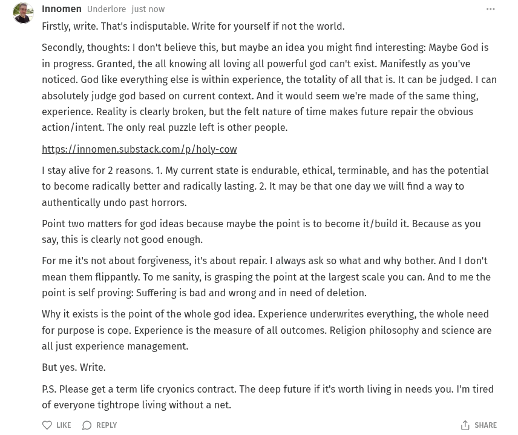

# Public Take transcript

## Machine transcription

Innomen Underlore just now

Firstly, write. That's indisputable. Write for yourself if not the world.

Secondly, thoughts: | don't believe this, but maybe an idea you might find interesting: Maybe God is
in progress. Granted, the all knowing all loving all powerful god can't exist. Manifestly as you've
noticed. God like everything else is within experience, the totality of all that is. It can be judged. | can
absolutely judge god based on current context. And it would seem we're made of the same thing,
experience. Reality is clearly broken, but the felt nature of time makes future repair the obvious
action/intent. The only real puzzle left is other people.

https://innomen.substack.com/p/holy-cow

I stay alive for 2 reasons. 1. My current state is endurable, ethical, terminable, and has the potential
to become radically better and radically lasting. 2. It may be that one day we will find a way to
authentically undo past horrors.

Point two matters for god ideas because maybe the point is to become it/build it. Because as you
say, this is clearly not good enough.

For me it's not about forgiveness, it's about repair. | always ask so what and why bother. And | don't
mean them flippantly. To me sanity, is grasping the point at the largest scale you can. And to me the
point is self proving: Suffering is bad and wrong and in need of deletion.

Why it exists is the point of the whole god idea. Experience underwrites everything, the whole need

for purpose is cope. Experience is the measure of all outcomes. Religion philosophy and science are

all just experience management.
But yes. Write.

PS. Please get a term life cryonics contract. The deep future if it's worth living in needs you. I'm tired
of everyone tightrope living without a net.

Q UKE [ RepLY ) SHARE
