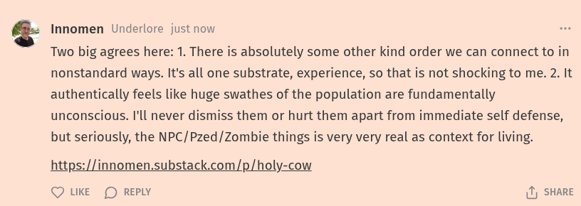

# Public Take transcript

## Machine transcription

Innomen Underlore just now

Two big agrees here: 1. There is absolutely some other kind order we can connect to in
nonstandard ways. It's all one substrate, experience, so that is not shocking to me. 2. It
authentically feels like huge swathes of the population are fundamentally
unconscious. I'll never dismiss them or hurt them apart from immediate self defense,

but seriously, the NPC/Pzed/Zombie things is very very real as context for living.
https://innomen.substack.com/p/holy-cow
Q UKE () REPLY

(1) SHARE
