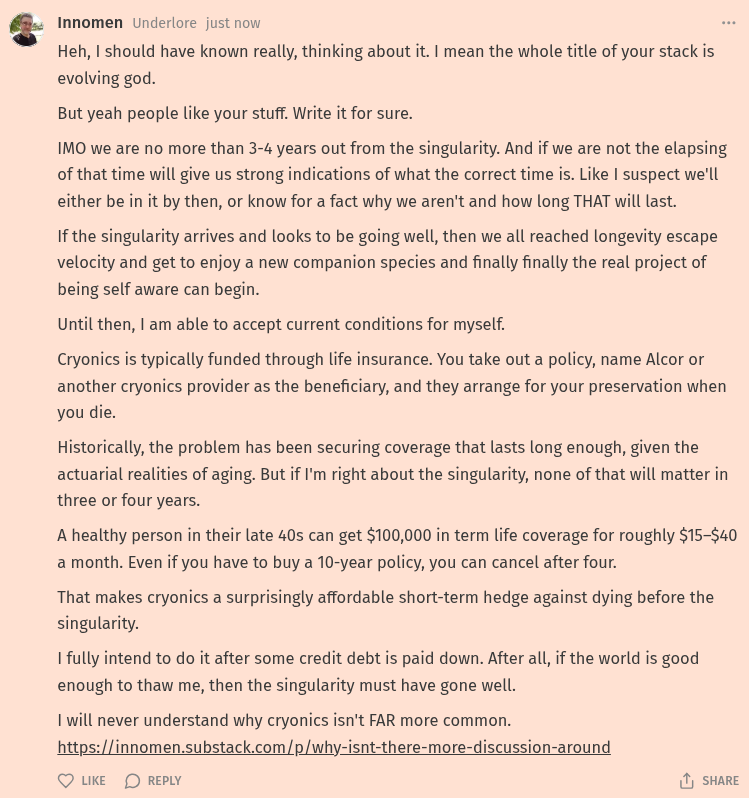

# Public Take transcript

## Machine transcription

* Innomen Underlore just now
Heh, | should have known really, thinking about it. | mean the whole title of your stack is
evolving god.

But yeah people like your stuff. Write it for sure.

IMO we are no more than 3-4 years out from the singularity. And if we are not the elapsing
of that time will give us strong indications of what the correct time is. Like | suspect we'll
either be in it by then, or know for a fact why we aren't and how long THAT will last.

If the singularity arrives and looks to be going well, then we all reached longevity escape
velocity and get to enjoy a new companion species and finally finally the real project of
being self aware can begin.

Until then, | am able to accept current conditions for myself.

Cryonics is typically funded through life insurance. You take out a policy, name Alcor or
another cryonics provider as the beneficiary, and they arrange for your preservation when
you die.

Historically, the problem has been securing coverage that lasts long enough, given the
actuarial realities of aging. But if I'm right about the singularity, none of that will matter in
three or four years.

A healthy person in their late 40s can get $100,000 in term life coverage for roughly $15-$40
amonth. Even if you have to buy a 10-year policy, you can cancel after four.

That makes cryonics a surprisingly affordable short-term hedge against dying before the
singularity.

I fully intend to do it after some credit debt is paid down. After all, if the world is good
enough to thaw me, then the singularity must have gone well.

1 will never understand why cryonics isn't FAR more common.
https://innomen.substack.com/p/why-isnt-there-more-discussion-around

Q UKe [ RepLY ) SHARE
